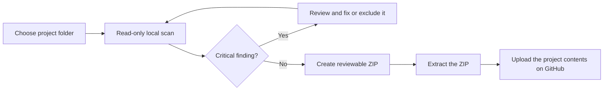

<div align="center">
  
  <h1>PushLens</h1>
  <p><strong>Know what you're about to upload.</strong></p>
  <p>A local-first GitHub publishing preflight for people who want to share a project without learning Git first.</p>
</div>

<p align="center">
  <a href="README_TR.md">Türkçe</a> ·
  <a href="#quick-start">Quick start</a> ·
  <a href="#what-it-checks">What it checks</a> ·
  <a href="ROADMAP.md">Roadmap</a> ·
  <a href="docs/SECURITY.md">Security & privacy</a>
</p>

---

You have a folder full of code and want to put it on GitHub. Before you drag it into a public repository, PushLens checks for likely secrets, noisy build folders, missing project basics, and browser upload limits. If the scan has no critical finding, it can prepare a clean ZIP for you to review and upload.

**No Git. No account. No upload. No extra runtime packages.** PushLens only reads the folder you select; it never edits your source files.

## Quick start

Requires Python 3.10 or later. The scanner uses only the Python standard library. The optional desktop app uses `tkinter`.

### Windows: open the desktop app

1. Download or extract this project.
2. Double-click `Launch_PushLens.bat`.
3. Choose your project folder and click **Check project**.
4. Review the findings. If no critical findings remain, use **Create clean ZIP…**.

If Windows can't find Python, install Python from [python.org](https://www.python.org/downloads/) and enable **Add python.exe to PATH** during setup. The GUI requires a Python distribution that includes Tkinter.

### Command line

From the PushLens project folder:

```powershell
$env:PYTHONPATH = "$PWD\src"
python -m pushlens check "C:\path\to\your\project"
```

Create a clean source archive after reviewing the scan:

```powershell
python -m pushlens pack "C:\path\to\your\project"
```

Install the command for repeated use (the installer uses setuptools as a build dependency; runtime dependencies remain empty):

```powershell
python -m pip install .
pushlens check "C:\path\to\your\project"
pushlens pack "C:\path\to\your\project"
```

The archive is created beside the project by default as `<folder>-github-upload.zip`. It contains a top-level project folder. **Extract it before using GitHub's browser uploader**; GitHub will otherwise store the ZIP as one file.

### Other commands

```text
pushlens check . --format json       Machine-readable results
pushlens check . --report audit.md   Save a Markdown report
pushlens check . --list-files        Print every file included in a clean ZIP
pushlens check . --strict           Exit non-zero on warnings (useful in automation)
pushlens gui                        Open the desktop interface
pushlens --version                  Print version
```

`check` returns exit code `2` when a critical finding blocks bundling, `1` for warnings with `--strict`, and `0` otherwise.

## What it checks

| Area | Examples | Result |
|---|---|---|
| Likely credentials | `.env`, credential/private-key filenames, common AWS/GitHub/GitLab/Stripe tokens, long password/token/API-key assignments | Critical; matched content values are never printed |
| Upload constraints | More than 100 files in one browser batch, or a file larger than 25 MiB | Warning with the affected file/count |
| Project hygiene | Missing README or `.gitignore`; no license detected | Suggestions, never automatic edits |
| Generated clutter | `.git`, virtual environments, caches, `node_modules`, build output | Excluded from the inventory and ZIP |
| Symbolic links | Symlinked files and directories (including Windows directory junctions) | Skipped; directory links are never followed |
| Scan boundaries | Text files over 2 MiB, unreadable files | Warned about, not silently treated as safe |

See the [finding reference](docs/RULES.md) for rule IDs, severity, and suggested next steps.

The ignore list aims at common generated folders, not source folders. Add project-specific exclusions to a `.pushlensignore` file at the project root, one relative path or glob per line:

```gitignore
# Local build output
artifacts/
*.sqlite
customer-dump-*.csv
```

PushLens does **not** interpret `.gitignore` yet. The GitHub browser uploader also ignores those rules. If a file should stay out of the release, add its path to `.pushlensignore`, then create and inspect the ZIP.

## The upload flow



PushLens does not create a GitHub repository or sign in to your account. It prepares the files; you choose the repository name, description, visibility, topics, and commit on GitHub.

For a browser-based publishing walkthrough and copy-ready repository description/topics, see [Publish PushLens on GitHub](docs/GITHUB_PUBLISHING.md). Türkçe adımlar: [PushLens'i GitHub'a yükleme](docs/GITHUB_YAYINLAMA.md).

See [ROADMAP.md](ROADMAP.md) for ideas the project may explore next.

## Privacy & safety

- Scanning is entirely offline. PushLens does not make network requests or send telemetry.
- Source files are read-only. PushLens scans a temporary snapshot and writes the ZIP to a separate path.
- Reports include file paths, rule IDs, and line numbers, but **never matched file-content values or code snippets**. Review file names before sharing a report.
- Critical findings prevent ZIP creation. Remove the credential from the file, or add the path to `.pushlensignore` if you intend to keep a private local file outside the release.
- The scanner uses bounded reads and does not follow symlinks.

PushLens is a conservative checklist, **not a secret-scanning guarantee**. Pattern matching can miss credentials, and ordinary text can look like a credential. Review the complete file list and inspect the ZIP before publishing. A ZIP made with PushLens does not remove secrets from Git history or from other copies of a file.

Read the full [security and privacy notes](docs/SECURITY.md).

## Why build this?

Git makes the normal developer workflow powerful, but it adds a learning step before a beginner can share a small project. GitHub also supports uploading files through the browser. PushLens fills the gap before that upload: it gives a new maintainer a local checklist and a clean package without asking them to install Git or hand their files to a website.

## Contributing

Bug reports and focused improvements are welcome. Please include the PushLens version, operating system, and a **synthetic** reproduction when reporting a scanner issue; never attach a real secret or private project file. See [CONTRIBUTING.md](CONTRIBUTING.md).

## License

MIT. See [LICENSE](LICENSE).

---

<sub>Built for the moment before “Upload files.”</sub>
